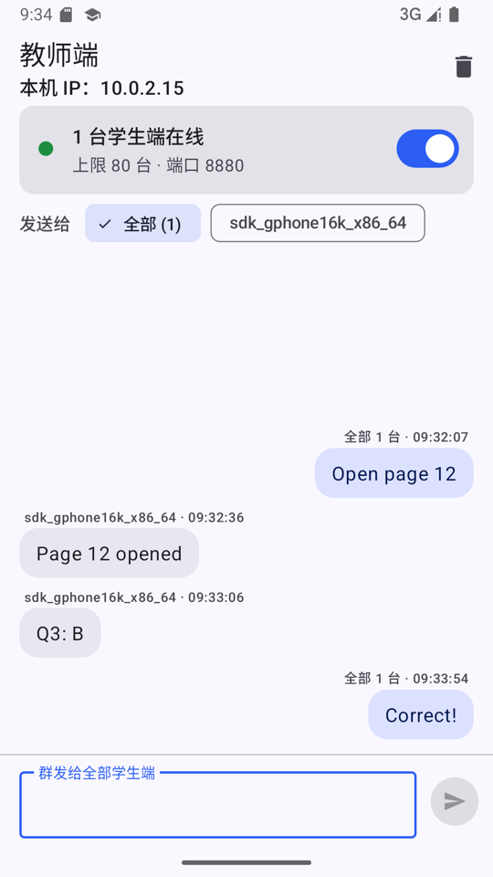
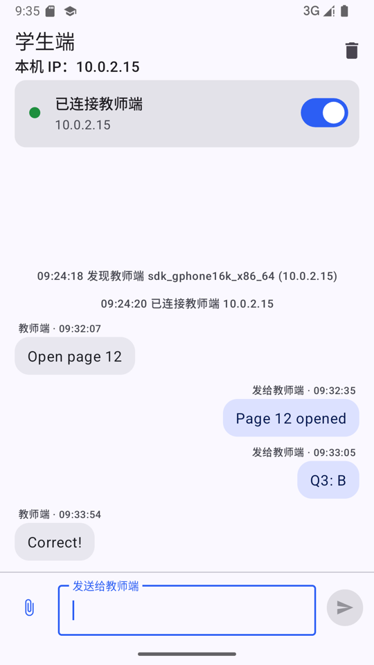
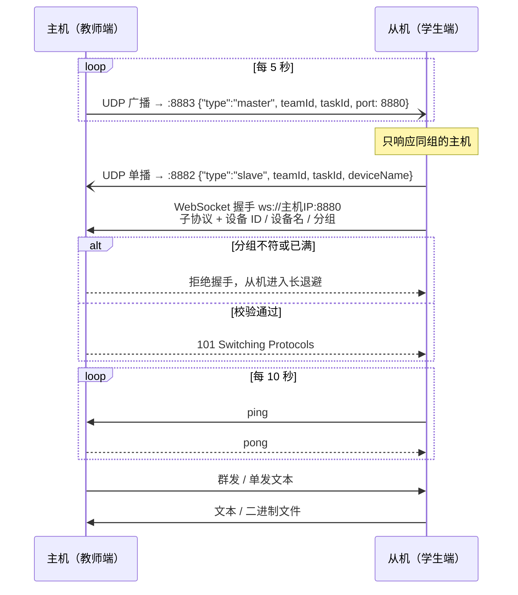

<div align="center">

# WebSocket 局域网组网通讯

**不依赖服务器，在同一个 Wi-Fi 或热点下，让一台 Android 设备连接并管理几十台设备**


[](LICENSE)

</div>

一个用于 Android 局域网**一对多**通信的组网库，附带两个演示 App。
主机通过 UDP 广播被自动发现，从机用 WebSocket 连接主机，之后双方可以收发文本和文件。

项目最初用于课堂场景：教师 Pad（主机）向全班学生 Pad（从机）下发指令，学生端响应并回传结果。
任何"一台主控 + 多台终端"的局域网场景都适用，例如会议投屏、展厅设备联动、门店多屏控制。

> 文中「主机 / 教师端 / 服务端」指同一个角色，「从机 / 学生端 / 客户端」指另一个角色。

## 目录

- [截图](#截图)
- [特性](#特性)
- [快速开始](#快速开始)
- [集成到你的项目](#集成到你的项目)
- [工作原理](#工作原理)
- [项目结构](#项目结构)
- [注意事项](#注意事项)
- [测试](#测试)
- [路线图](#路线图)
- [致谢](#致谢)
- [许可证](#许可证)

## 截图

| 教师端（主机） | 学生端（从机） |
| :---: | :---: |
|  |  |

## 特性

- **零配置发现**：主机周期性 UDP 广播，从机自动找到同组主机，不需要手动输入 IP，开启顺序不分先后
- **一对多通信**：支持群发和单发，支持文本和二进制文件（单个文件不超过 15MB），默认最多 80 台从机
- **分组隔离**：按 `teamId + taskId` 分组，同一网络里的多个班级互不干扰，其他分组的设备会在握手阶段被拒绝
- **稳定的长连接**：
  - 断线检测：从机 ping/pong 心跳，主机自动清理失效连接
  - 自动重连：指数退避加随机抖动，先直连上次的主机，失败后回到广播搜索
  - 设备识别：按设备 ID 识别，同一台设备重连时新连接顶替旧连接
  - 后台保活：组网期间持有 WifiLock，教师端运行在前台服务中，切到后台、锁屏都不会断线
- **兼容 1.0**：端口、发现包格式与 1.0 一致，1.0 的从机仍然可以接入
- **组网库与 UI 解耦**：组网库 `lan-core` 不依赖任何界面组件，所有回调都在主线程，可以直接接入业务 App

## 快速开始

### 环境要求

- JDK 17 及以上
- Android SDK（compileSdk 35）
- 两台连接同一 Wi-Fi 或热点的 Android 5.0+ 设备。也可以把两个 App 装在同一台设备上联调

### 构建与运行

```bash
git clone https://github.com/yuqianglianshou/WebSocket.git
cd WebSocket
./gradlew assembleDebug
```

生成的两个 APK：

| 模块 | 说明 | APK 路径 |
| --- | --- | --- |
| `server` | 教师端（主机） | `server/build/outputs/apk/debug/server-debug.apk` |
| `client` | 学生端（从机） | `client/build/outputs/apk/debug/client-debug.apk` |

1. 在主机设备上安装教师端，在从机设备上安装学生端
2. 两端分别打开状态卡片上的开关
3. 通常 5 秒内完成连接：教师端显示在线人数和设备名，学生端显示"已连接教师端"
4. 在底部输入框发送消息。教师端可以选择群发或单发，学生端可以点回形针图标发送文件

## 集成到你的项目

### 1. 引入模块

`lan-core` 目前没有发布到 Maven 仓库。把 `lan-core` 目录复制到你的工程里，然后：

```groovy
// settings.gradle
include ':lan-core'

// app/build.gradle
dependencies {
    implementation project(':lan-core')
}
```

`lan-core` 的依赖：OkHttp 4.12（从机）、Java-WebSocket 1.5.7（主机）。所需的网络权限会通过 Manifest 合并自动加入。

### 2. 主机（教师端）

```java
MasterControlManager master = new MasterControlManager(context, LanConfig.defaults());
master.setCallback(new MasterControlManager.Callback() {
    @Override public void onRunningChanged(boolean running) { }
    @Override public void onServerError(Exception e) { }
    @Override public void onSlaveDiscovered(String ip, DiscoveryMessage info) { }
    @Override public void onClientConnected(ClientInfo client, int total) { }
    @Override public void onClientDisconnected(ClientInfo client, int total) { }
    @Override public void onMessage(ClientInfo client, String message) { }
    @Override public void onFileReceived(ClientInfo client, File file) { }
});
master.start();

master.broadcast("上课了");                // 群发，返回送达的连接数
master.sendTo(client.id, "请回答第 3 题");   // 单发，client 来自回调或 connectedClients()
master.stop();
master.release();                         // 宿主销毁时调用
```

> 建议把主机放在前台 Service 中，否则切到后台后进程可能被系统回收，全班随之断线。
> 可以参考 `server` 模块的 [`MasterService`](server/src/main/java/com/lq/websocket/MasterService.java) 和 [`MasterSession`](server/src/main/java/com/lq/websocket/MasterSession.java)。

### 3. 从机（学生端）

```java
SlaveControlManager slave = new SlaveControlManager(context, LanConfig.defaults());
slave.setCallback(new SlaveControlManager.Callback() {
    @Override public void onStateChanged(SlaveControlManager.State state, String masterIp) { }
    @Override public void onMasterFound(String masterIp, DiscoveryMessage info) { }
    @Override public void onMessage(String message) { }
    @Override public void onRetryScheduled(long delayMs, Exception cause) { }
});
slave.start();             // 自动发现、连接、断线重连

slave.send("收到");
slave.sendBytes(bytes);    // 二进制数据，上限见 SlaveControlManager.maxSendBytes()
slave.sendFile(file);
slave.stop();
slave.release();
```

从机的状态依次为 `IDLE → SEARCHING → CONNECTING → CONNECTED`，断线后进入 `WAITING`，按退避时间重试。

### 4. 线程模型

所有公开方法都应在**主线程**调用，所有回调也都在**主线程**执行，网络线程对调用方透明。
管理器建议放在 ViewModel 或 Service 中，不要放在 Activity 里，否则旋转屏幕就会断开连接。

### 配置项

通过 `LanConfig.builder()` 修改，主从两端的分组、端口和子协议必须一致：

| 参数 | 默认值 | 说明 |
| --- | --- | --- |
| `teamId` / `taskId` | `Speakin` / `Test` | 分组标识，两者都相同才能互相发现和连接 |
| `wsPort` | `8880` | 主机 WebSocket 端口 |
| `wsProtocol` | `speakinchat` | WebSocket 子协议 |
| `masterListenPort` | `8882` | 主机接收从机 UDP 回复的端口 |
| `slaveListenPort` | `8883` | 从机接收主机 UDP 广播的端口 |
| `broadcastIntervalMs` | `5000` | 主机广播间隔 |
| `maxSlaves` | `80` | 最大从机数量，满员时拒绝新连接 |
| `heartbeatIntervalMs` | `10000` | 从机 ping 间隔，按时收不到 pong 即判定断线 |
| `heartbeatTimeoutMs` | `30000` | 主机清理无响应连接的超时时间 |
| `reconnectDelayMs` | `2000` | 重连退避的基础时长，上限 30s |

```java
LanConfig config = LanConfig.builder()
        .teamId("Grade3")
        .taskId("Class2")
        .maxSlaves(50)
        .build();
```

## 工作原理

### 通信流程



1. **发现**：UDP 是无连接的，接收方收到广播后就知道了发送方的 IP。主机向 `255.255.255.255` 和每个网卡的定向广播地址（例如热点网段 `192.168.43.255`）发送广播，不依赖某一种网络环境
2. **回应**：从机校验分组后，向主机单播回复。主机由此得知从机的存在，从机也拿到了主机的 IP 和 WebSocket 端口
3. **握手**：从机发起 WebSocket 连接，握手请求头里带上设备身份和分组。主机在握手阶段完成校验，被拒绝的从机会收到明确的失败，而不是"连上后又被断开"
4. **保活**：从机定时 ping，能较快发现 Wi-Fi 静默断开。主机清理长时间无响应的连接
5. **重连**：断线后按指数退避重试（2s 起，上限 30s，±20% 抖动），避免几十台设备同时冲击主机。前两次直连上次的主机，之后回到 UDP 搜索

### 握手约定

| 请求头 | 说明 |
| --- | --- |
| `Sec-WebSocket-Protocol` | 子协议，必须与主机一致 |
| `X-Lan-Device-Id` | 设备唯一 ID，首次启动时随机生成并持久化。同一 IP 下有多台设备（例如经过 NAT）时也能区分 |
| `X-Lan-Device-Name` | 设备名，URL 编码，支持中文 |
| `X-Lan-Team` / `X-Lan-Task` | 分组，不符时拒绝握手 |

以上请求头都是可选的，缺失时（例如 1.0 的从机）主机退回到按 IP 识别设备。

| 关闭码 | 含义 |
| --- | --- |
| `1013` | 主机已满（Try Again Later） |
| `4001` | 被同一设备的新连接顶替 |

## 项目结构

```
WebSocket/
├── lan-core/      组网库（无 UI），主从机逻辑都在这里
│   ├── LanConfig / LanProtocol   可调参数 / 握手约定
│   ├── discovery/                UDP 发现：DiscoveryMessage、UdpSender/Receiver、Master/SlaveDiscovery
│   ├── master/                   MasterServer（Java-WebSocket）、MasterControlManager（门面）、ClientInfo
│   ├── slave/                    SlaveClient（OkHttp）、SlaveControlManager（状态机 + 退避重连）
│   └── net/                      NetUtils、WifiLocks、DeviceIdentity
├── app-common/    两个演示 App 共用的 UI：Material 3 主题、消息列表、状态卡片、全面屏适配
├── server/        教师端：MasterService（前台服务）、MasterSession（进程级状态）、ViewModel、Activity
└── client/        学生端：SlaveViewModel、Activity
```

分层：`Activity → ViewModel → ControlManager → 网络层`。

- Activity 只负责渲染和转发用户操作
- ViewModel 持有界面状态（LiveData），旋转屏幕、切换深色模式不会断开连接
- 教师端的管理器放在进程级的 `MasterSession` 中，由前台服务 `MasterService`（类型 `connectedDevice`）承载。退出页面后服务仍在运行，通知栏显示在线人数和本机 IP，可以从通知栏停止服务

技术选型：OkHttp 只提供 WebSocket 客户端，所以从机使用 OkHttp 4.12，主机使用纯 Java 实现的 Java-WebSocket 1.5.7。

## 注意事项

- **明文连接**：局域网通信使用 `ws://`。OkHttp 遵守系统的网络安全策略，targetSdk ≥ 28 时默认禁止明文连接，
  所以 `lan-core` 在 Manifest 中声明了 `usesCleartextTraffic="true"`。局域网 IP 不固定，无法用 network-security-config 按网段放行。
  如果需要加密，请改用 `wss://`
- **通知权限**：Android 13+ 首次开启教师端服务时会请求通知权限。拒绝也不影响服务运行，只是看不到常驻通知
- **网络环境**：部分企业或公共 Wi-Fi 开启了 AP 隔离，或者屏蔽了广播，设备之间无法互相发现。这时请改用手机热点或普通家用路由器
- **文件接收位置**：主机收到的文件保存在 `Android/data/<包名>/files/receive/` 目录，不需要存储权限

## 测试

```bash
./gradlew :lan-core:testDebugUnitTest
```

测试会在 JVM 上启动真实的 WebSocket 服务端和客户端，覆盖：

- 发现包的编解码与分组校验
- 双向文本 / 二进制收发，中文设备名
- 子协议不符、分组不符、满员时拒绝握手
- 同一设备重连时顶替旧连接
- 连接失败、对端关闭、主动关闭时的回调
- 退避策略、网卡优先级

## 路线图

- [x] 主机运行在前台服务中，切到后台不断线
- [ ] 大文件分片传输与断点续传，携带文件名等元数据
- [ ] 定义带 `type` / `id` 的 JSON 消息信封，支持 ACK 与超时重发
- [ ] 学生端前台服务（按需）
- [ ] 将 `lan-core` 发布到 Maven 仓库

版本变化见 [CHANGELOG.md](CHANGELOG.md)。

## 致谢

- 1.0 基于 [szuwest/Recorder](https://github.com/szuwest/Recorder) 修改，「UDP 发现 + WebSocket 通信」的思路来自原作者，感谢分享。2.0 的代码已全部重写

## 许可证

本项目基于 [MIT License](LICENSE) 开源。
